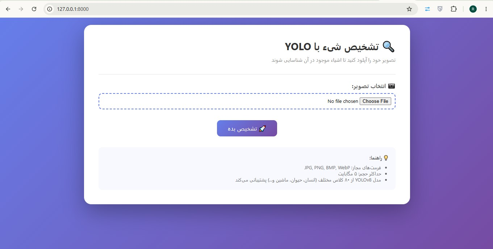
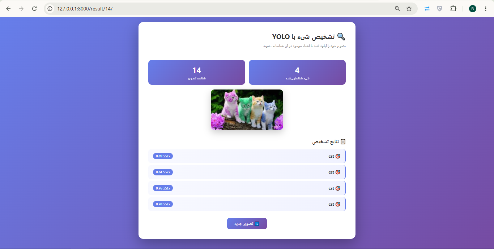
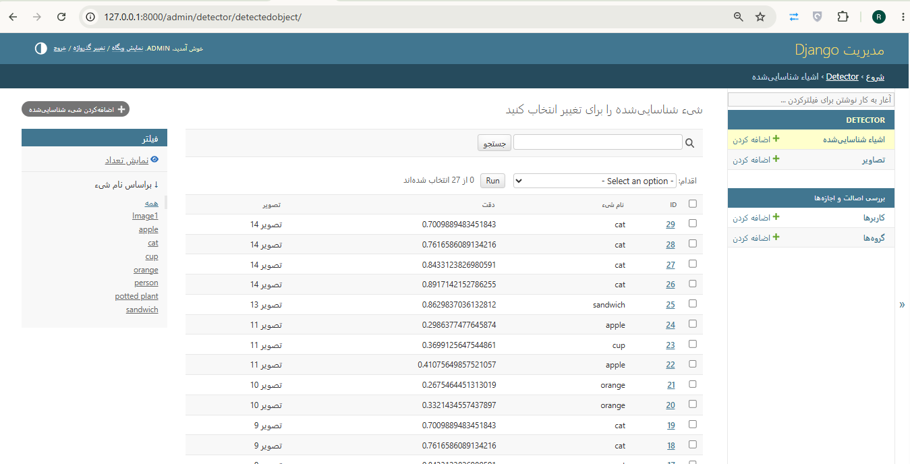

# 🔍 تشخیص شیء با Django + YOLO

یک وب‌اپلیکیشن برای تشخیص خودکار اشیاء در تصاویر با استفاده از **YOLOv8** و **Django**.

---

## ✨ امکانات

- 📤 آپلود تصویر
- 🤖 تشخیص خودکار با YOLOv8
- 💾 ذخیره در دیتابیس
- 📊 نمایش دقت هر تشخیص
- 🎨 رابط کاربری مدرن RTL

---

## 📸 اسکرین‌شات‌ها

### صفحه‌ی آپلود


### صفحه‌ی نتیجه


### پنل ادمین


---

## 🛠️ تکنولوژی‌ها

- Python 3.10+
- Django 5.0+
- YOLOv8
- OpenCV
- SQLite (Development)
- MySQL (Production)

---

## 🚀 نصب و اجرا

```bash
git clone https://github.com/USERNAME/django-yolo.git
cd django-yolo
python -m venv venv
venv\Scripts\activate
pip install -r requirements.txt
python manage.py migrate
python manage.py createsuperuser
python manage.py runserver